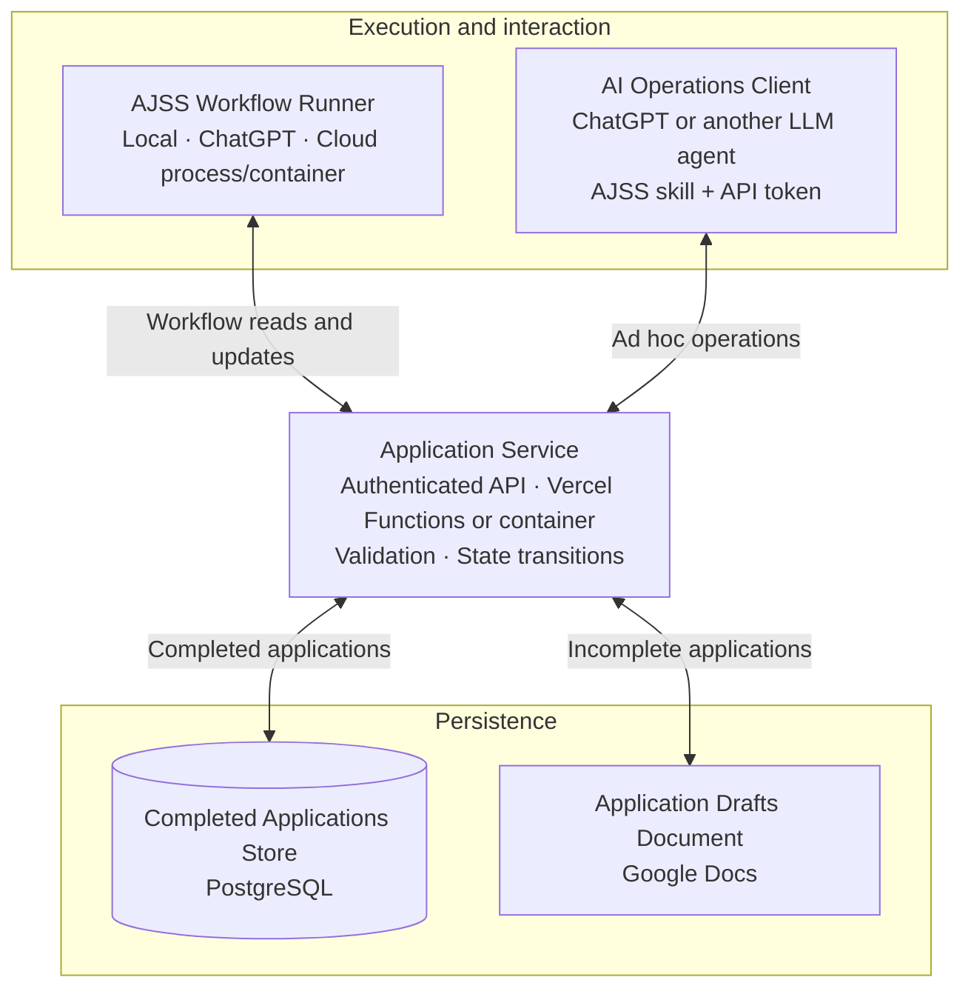

# Job Search Automation

This project implements an automated job-search system with time-driven polling
workflows. The workflows are autonomous, and their agents are
stateless and side-effect free. A workload instance gathers context, asks an
agent for a structured decision, and applies the decision through the
Application Service.

## Overview

The system polls queues and external sources to run these workflow groups:

1. **Job discovery and bookmarking** — scheduled scans save postings as `Discovered`. The bookmark workflow reads and saves their role descriptions, moving them to `Bookmarked`.
2. **Validation** — compare each bookmarked role description with the candidate’s experience to confirm a strong match. Matching postings move to `Validated` before preparation.
3. **Preparation** — each validated posting receives a personalized cover letter and resume PDF. Successful packages move to `Prepared`.
4. **Auto-apply** — items in the ready queue are submitted automatically. Confirmed submissions become `Applied`; failures go to `Manual Apply Required` or `Dead Letters Queue`.
5. **Recruitment correspondence** — incoming emails are matched to applications and classified. Rejections, offers, and interview invitations update the application state.

Each application follows this lifecycle:

```text
Discovered → Bookmarked → Validated → Prepared → Applied → Interviewing → Offer / Rejected
```

All application-state mutations go through the Application Service; workflow agents never touch external systems directly. The current persistence implementation records state changes in a Google Docs journal. See [Architecture](#architecture) for the target component model.

Automatic interview preparation polls Calendar once every 24 hours by default
(`prepare-interview`, `cadence: day`). Other workflows retain minute polling.
The continuous scheduler checks due work on its shared 60-second clock;
`poll_kind` distinguishes state queues, external sources, and scheduled checks.
Set `pipelines.interview.event_poll_seconds` in `config/pipelines.json` to override
the daily default (86400 seconds). The first poll runs when the scheduler starts;
its timer resets on scheduler restart. This is an elapsed interval, not a fixed
local time of day. Explicit CLI and ChatGPT workflow requests still run on demand.

The continuous orchestrator admits work only when a thread is free in its shared pool and a
workflow has an available configured worker. It never queues tasks behind a
full pool. Running work is harvested between polls, but newly freed slots wait
until the next minute. Email, calendar, and maintenance checks use that pool too.
The legacy daemon's continuous mode delegates to this same orchestrator.

Discovery counts **all tabs in the main journal**, including state and research
tabs. Its maximum new postings for that poll is `max(0, 100 - tab_count)`. That
budget is divided among available discovery workers, passed to source queries,
and checked again before each save. The Application Service enforces the same
limit under its installation lock, so concurrent discovery cannot exceed the
remaining capacity. At 100 or more tabs, discovery makes no source requests.

Scheduled checks use minute-based IDs shared across runners and restarts.
A queued or running check is reused rather than adding a backlog of minute ticks.
Internal event envelopes carry found work to workers; external messages and
calendar changes are discovered by polling. Live reconciliation does not reset
active workers.

Journal completion uses `POST /journal/complete-terminal`; the Application
Service owns completion and removal of terminal journal tabs. Agents remain
stateless and application-state writes remain behind that API.

## First run

1. **Install dependencies and authenticate the agent provider** — `python3 -m pip install -r requirements.txt`; run `codex --login` for the default provider.
2. **Configure the system** — run `python3 -m services.onboarding` if `config/runtime.json` is missing. Have `gcloud`, OpenSSL and an authenticated agent provider available. The wizard grants a service account Editor access to your chosen Drive folder, creates `Applications` and `Applicant`, waits for your résumé PDF in `Applicant`, then extracts and verifies `Applicant/applicant_profile.json`. It cannot complete without a readable résumé and a saved profile.
3. **Provision infrastructure** — see [deployment/README.md](deployment/README.md). Drive root: `./deployment/ctl.sh drive` (the folder is `drive_path` in `deployment/defaults.json`)
4. **Start the configured runtime** — use the commands below.

Once configured, you can:

- **Process Discovered queue** (bookmark workflow): `python3 -m services.run_single Discovered`
- **Process Bookmarked and Ready queues** (8 threads): `python3 -m services.concurrent_queues`
- **Run continuously**: `python3 -m services.orchestrator run`
- **Monitor queues**: `python3 -m services.run --monitor`

For detailed operational reference, see [Running the system](#running-the-system) below.

## Connect through MCP

The Application Service exposes **`https://ajss-one.vercel.app/mcp`** over
Streamable HTTP. Remote MCP clients can connect with OAuth; the owner authorizes
on the AJSS consent page using the existing service token. The tools mirror the
OpenAPI domain operations and include reads and writes. Start with the read-only
`journalQueueCounts` tool. MCP access does not start workflow workers.

`./deployment/ctl.sh chatgpt` verifies the endpoint and generates private
connection files. `./deployment/ctl.sh codex` registers the local stdio launcher
in the host's Codex CLI. See the [endpoint reference](application_service/README.md#mcp-endpoint)
for authentication and tool arguments, and the [deployment guide](deployment/README.md#mcp-connections)
for connection commands and provisioning behavior.

## Running the system

### Queue runners

**Bookmark workflow** — `python3 -m services.run_single Discovered` processes one position from the `Discovered` queue through the bookmark workflow. Add `--all` to process all positions. For a specific application: `--application-id <id>`. To read a posting URL without any workflow: `python3 -m services.agent_cli read-posting --url https://...`.

The bookmark workflow extracts the posting content and saves it as a `Job Posting - Company - Role.json` artifact. Preparation reads that saved artifact through the Application Service; missing or mismatched content stops preparation rather than re-fetching.

**Single ready submission** — Process one `Prepared` position:
```bash
python3 -m services.ready_submission --application-id <application_id>
```

**Bounded system run** — `python3 -m services.system_run` processes Ready queue with per-workload activity and a persisted PDF report. Email and interview workflows poll Gmail (last 14 days) and Calendar (next 30 days) read-only. Ambiguous matches are skipped; event IDs prevent duplicates.

**Concurrent queues** — `python3 -m services.concurrent_queues` consumes Bookmarked and Prepared with eight posting threads. Preparation successes continue into submission in the same pool. One shared persistence client serializes all I/O; per-posting locks prevent duplicate work. A process lock prevents two runner copies. Do not run a separate daemon against the same registries.

### Continuous operation

**Orchestrator** — `python3 -m services.orchestrator run` holds the process lock and routes agent outcomes from `config/pipelines.json`. Scale live: `python3 -m services.orchestrator scale scout 2` (use `0` to pause). Scout searches `discovery_sources` every `discovery_seconds` and once at start. Preparation consumes `Bookmarked`; auto-apply consumes `Prepared`.

**Duplicates** — Scout and preparation send duplicates of Applied, Interviewing, Rejected, or Offer postings to `Duplicate`. Moving to Applied or Rejected also retires matching items in Discovered, Bookmarked, Ready, or Manual Apply. The journal needs a top-level `Duplicate` tab for these moves.

**Single-process runner** — Start the Application Service and pipelines in one process:
```bash
python3 -m services.run --monitor --log --log-file activity.log --workers scout=2 --workers preparation=4 --workers auto-apply=1
```
`--monitor` redraws queue counts once a second. `--log` toggles the activity log. Flags override `config/runtime.json`. Stop any older `application_service.main` first.

**Queue monitor** — `python3 -m services.queue_monitor` and `python3 -m services.orchestrator monitor` redraw counts against an already-listening API.

### Logging

**Activity log** — Off by default. Enable via `activity_log` in `config/runtime.json` (set `enabled` and `path`), or environment variables `ACTIVITY_LOG_ENABLED` and `ACTIVITY_LOG_FILE`. Records every state transition and worker start/finish. The Application Service reads this at startup — restart it after enabling.

**API log** — Separate file, off by default. Configure via `api_log` in `config/runtime.json` or `API_LOG_ENABLED` and `API_LOG_FILE`. Default path is `logs/application-service.log`.

### Submission

**Auto-apply policy** — Ready queue membership authorizes automatic submission; no approval pause. Failed auto-apply moves to `Manual Apply Required` with the agent's failure explanation. System errors (config, unexpected exceptions, preparation failures) move to `Dead Letters Queue`. Unconfirmed submissions require manual reconciliation before retry. Dead letters are never consumed automatically.

**Browser adapter** — Default adapter uses local Chrome and Playwright for Comeet forms. Run `npm install` and ensure `google-chrome` or `chromium` is on PATH. Configure `JOB_SUBMISSION_ADAPTER=module:callable` to override. Unsupported destinations report `Blocked` and move to `Manual Apply Required`.

**Learned job-board routes** — Verified trial findings for Jobify, RVC Global, and EchoJobs live in `adapters/browser/playbooks/`. Start a trial: `BROWSER_HEADLESS=false node adapters/browser/trial_session.cjs jobify`. Progress is stored under `submit/site-trials/<site>/<application_id>.json`. Inspect with `python3 -m services.site_trial_state --site jobify --application-id <id>`.

### Storage

**Performance** — Journal reads share a five-second snapshot. Drive folder/file identities cached for 60 seconds. Report checkpoints upload after 10 postings or 60 seconds. Tune cache, checkpoint, and HTTP timeout values in `.env.example`; restart the API after changes.

**Profile storage** — Profile is at `Applicant/applicant_profile.json` in Drive. Internal workload files use `.ai-job-search-system/workloads-internal-state/<workflow>/`. Migration endpoint: `POST /storage/migrate-internal`.

**Artifacts** — Upload via `POST /applications/{application_id}/artifacts` with filename, MIME type, and base64 content. Use `idempotency_key` for retryable uploads. List with `GET`, read as base64 by artifact ID. Generic root-relative endpoints (`POST /files`, `GET /files?path=...`) for non-application artifacts.

**Interview research** — `POST /applications/{application_id}/research` creates a nested research tab. Inspect prior briefings via the corresponding `GET` endpoint.

### Configuration

**Onboarding** — `python3 -m services.onboarding` collects journal, scheduling and country settings, then sets up service-account access to an existing Drive folder you choose. Immediately afterward it creates `Applications` and `Applicant`, prints the Applicant folder link and blocks until you upload a readable résumé PDF. The stateless profile-extraction agent runs only after that gate, then you confirm your phone. The canonical result is `Applicant/applicant_profile.json`; `config/applicant_profile.json` is a local cache. Credentials remain under ignored `.onboarding/`, never in runtime.json. Use `python3 -m services.onboarding --applicant` to apply these stages to an existing installation or update its résumé. The same résumé hash reuses the extracted profile; multiple PDFs require explicit selection. Cancelling or failing leaves onboarding incomplete. See [the onboarding stages](docs/onboarding.md).

**Authentication** — Default provider is Codex CLI (`codex --login`). Google Drive requires OAuth: `GOOGLE_ACCESS_TOKEN` or `GOOGLE_REFRESH_TOKEN` with `GOOGLE_CLIENT_ID` and `GOOGLE_CLIENT_SECRET`.

**Reasoning effort** — Configure per-workflow presets in `config/workload-effort.json` (`low`, `medium`, `high`, `xhigh`). Reloaded each workload — no restart needed. Override file path with `WORKLOAD_EFFORT_CONFIG_PATH`.

**PDF dependencies** — `python3 -m pip install -r requirements.txt`. Application packages combine styled cover letter with original resume PDF from `source_resume.path`.

**Journal migration** — For existing journals, run `python3 -m services.journal_cli migrate-application-states --apply` before starting.

**External event polling** — `python3 -m services.external_event_polling` checks Gmail and Calendar without rerunning discovery/submission. Requires `gmail.readonly` and `calendar.events.readonly` OAuth scopes. Reauthorize the OAuth client after adding scopes — adding scopes alone doesn't update the refresh token.

**Preparation batch** — `python3 -m services.prepare_bookmarked_batch --migrate-review-holds` migrates prior review holds and reconsumes Bookmarked. Saved packages are validated and reused. Preparation failures go to `Dead Letters Queue`.

## Workflows

### A. Job discovery and application

Trigger: polling, once a minute when a worker is available.

```text
discover jobs
  → normalize postings
  → deduplicate
  → validate against preferences
  → personalize application
  → generate PDF
  → submit automatically from the ready queue
  → track result
```

Entering the `Prepared` queue authorizes the system to submit the
application automatically.

### B. Interview preparation

Trigger: a new or changed interview meeting.

```text
detect meeting
  → associate with application
  → research company, product, role, interviewer, and engineering culture
  → create interview briefing
  → track preparation status
```

### C. Recruitment correspondence

Trigger: incoming recruitment email.

```text
match email thread
  → classify intent
  → update application state or prepare response
  → send according to approval policy
```

### D. Reconciliation and recovery

Trigger: polling, once a minute when a worker is available.

```text
recheck missed events
  → recover incomplete workloads
  → reconcile application status
  → renew subscriptions
  → report errors and pending review requests for actions configured to ask
```

## Data layer

The data layer is the only component allowed to mutate persistent workflow
state. Agents and workflow instances use the API defined in `openapi.yaml`.
Google Drive is a persistence implementation, not an agent-facing API.

### Job-posting/application states

The main lifecycle and manual-submission path are:

```text
Discovered → Bookmarked → Validated → Prepared → Applied → Interviewing → Offer / Rejected

Prepared → Manual Apply Required → Applied (after verified manual submission)
```

Validation confirms a strong match between the role description and the candidate’s
experience before a posting enters `Validated`. See the [complete state-machine
diagrams](docs/state-machines.md) for invalidation, duplicates, errors and recovery.

`Rejected` and `Offer` are terminal for the current application attempt. The
implementation may later add explicit `Withdrawn` or `Skipped` states, but they
are not part of this initial documented lifecycle.

### Persistence representation

In the current Google Docs persistence implementation, the Interview Journal is
the canonical application state store. The target architecture separates incomplete
applications in Google Docs from completed applications in PostgreSQL, as shown
in [Architecture](#architecture). The current journal represents applications as follows:

- top-level tabs represent the supported lifecycle states;
- each application is a child tab under the state that currently contains it;
- an application tab is identified by its Google Docs tab ID;
- the tab title is the human-readable company / role label;
- each event is a date paragraph followed by one or more bullet paragraphs;
- manual and automated events use the same journal format;
- URLs written by the Application Service are native Google Docs hyperlinks;
- nested Research tabs remain children of the application tab and are treated as
  research artifacts, not separate applications;
- moving an application to another state updates the parent tab and appends a
  dated status-change event;
- artifact references are appended to the application journal after files are
  saved under one single-level folder named `Company / Role` inside
  `{Drive root}/Applications`. `application_root_path` can select a different
  root-relative parent.
  Company and role are not nested folders.
- posting URLs are canonicalized for deduplication: scheme/host casing,
  trailing slashes, fragments, and common tracking parameters do not create a
  second application.

Use `GET /journal/status` to validate the required state containers. A
missing container is reported rather than silently treated as an empty state;
repair is an explicit `POST /journal/repair` operation through the API.

Retryable writes carry an idempotency key. For Google Docs, the key is retained
as a small operation marker in the same event bullets and is removed from API
responses, allowing a restarted workload to reconcile without duplicating a
journal event.

## Architecture

See [workflow execution diagrams](docs/architecture.md) for the current deployment
and the proposed Vercel/ChatGPT execution split. See [state-machine diagrams](docs/state-machines.md)
for application lifecycle, workflow requests and workload execution states.

The target architecture separates workflow execution and ad hoc AI operations
from the backend that owns application state:



| Component | Responsibility |
| --- | --- |
| **AJSS Workflow Runner** | Executes time-driven polling workflows and reads or updates state through the backend API. Runs locally, within ChatGPT, or on a separately selected cloud process/container host. |
| **AI Operations Client** | Uses an AJSS skill and API token to perform ad hoc operations through the backend API. |
| **Application Service** | The system of record in front of Google Drive and PostgreSQL. It validates operations, manages state transitions, and is the only component that writes application state. Vercel Functions is the default cloud target. |
| **Completed Applications Store** | Stores completed applications in PostgreSQL. |
| **Application Drafts Document** | Stores incomplete applications in Google Docs. |

ChatGPT can host the Workflow Runner and act as an AI Operations Client; these
are distinct roles that can share an environment. Both roles access application
state through the Application Service, which owns all application-state mutations.
Workflow agents remain stateless decision-makers within the runner.

The diagram describes the target architecture. The current implementation uses
Google Docs for application state, including an optional separate completed
applications document; the PostgreSQL store is planned. Application artifacts
remain in Google Drive behind the API.

### Workflow execution flow

```text
event source
  → event dispatcher
    → AJSS Workflow Runner
      → stateless agent
        → structured decision
      → Application Service
        → Google Drive and PostgreSQL
```

The API contract is portable. Skills, prompts, and `AGENTS.md` files explain
how a particular agent runtime should use it; they are not the source of truth.
The deployable [`skills/application-service/SKILL.md`](skills/application-service/SKILL.md)
contains the operational boundary and usage rules for runtimes that support
skills. The OpenAPI contract remains authoritative for request and response
shapes.

### Runtime flow

Workflow runtimes should use `services.application_service_client.ApplicationServiceClient`
for reads and writes. This keeps the Google Drive implementation behind the
HTTP persistence boundary and prevents agents from acquiring external-system
access.

During discovery and application execution:

- The runtime passes discovery results between stateless agents as serialized
  context.
- Package writes go through the Application Service.
- Agents never hold a Drive client.

### Workload execution

`services.workload_executor` is the side-effect boundary inside a workload. It
validates agent results, produces explicit idempotent persistence operations,
and can execute them through the client or return them unchanged in dry-run
mode.

It also handles workflow-specific artifact preparation:

- When an application context includes `cv_html`, it plans a combined PDF
  artifact operation.
- Only execution mode sends generated bytes to the Application Service.
- When `calendly_url` is present, the document generator adds that scheduling
  link to the cover letter exactly once.

### Workload identity and recovery

Dispatcher workload IDs are deterministic for a supplied source event ID, so a
replayed calendar, email, or scheduled event can be reconciled instead of
creating a second logical workload.

`services.workload_registry.WorkloadRegistry` provides the corresponding
queued/running/failed/succeeded lifecycle and bounded recovery loop for the
reconciliation workflow.

When a reconciliation workload is claimed:

- Interrupted workloads return to `queued` until their retry limit is reached.
- An application reconciliation result can append a dated
  `reconciliation_completed` event and apply an explicitly supplied target
  status through the Application Service.
- The runtime returns registry counts and queued, failed, or dead-letter
  records requiring attention.
- When approval persistence is enabled, the result includes pending approval
  counts and records.

### API, adapter, agent, and skill boundaries

- The Application Service is the stable domain contract in `openapi.yaml`; it owns
  application-state and artifact mutations.
- An adapter/tool is an integration with an external system such as Google
  Drive, Gmail, Calendar, a job board, or a browser. Adapters normalize inputs
  and perform only the external action assigned to them.
- An agent is a stateless decision-maker. It receives serialized context and
  returns a schema-validated decision; it never receives an adapter or
  persistence client.
- A skill or `AGENTS.md` file is deployment-specific operating guidance for an
  agent runtime. It describes how to invoke the API and interpret contracts,
  but it is not a database and does not replace the API implementation.

This separation lets the same agent prompts run behind different LLM SaaS
providers while keeping Drive access in one replaceable persistence
implementation.

The repository includes provider-neutral adapter contracts and normalization
seams. Concrete Gmail, Calendar, job-board, browser, and LLM-provider clients
remain deployment-specific integrations; they should emit the normalized event
contracts in `adapters/contracts.py` and invoke the runtime/API boundaries
described above.

## Testing individual agents and workloads

The repository includes a side-effect-free contract runner. It lets you test a
specific agent or workload with fixture data before connecting credentials or
external adapters.

```bash
python3 -m services.test_runner list

python3 -m services.test_runner agent interview-prep \
  --fixture tests/fixtures/agents/interview-prep/input.json \
  --output tests/fixtures/agents/interview-prep/output.json

python3 -m services.test_runner workload prepare-interview \
  --fixture tests/fixtures/workloads/prepare-interview.json

python3 -m services.workload_runner prepare-interview \
  --fixture tests/fixtures/workloads/prepare-interview.json
```

Equivalent shortcuts are available through `make test`, `make list`,
`make dry-run-interview`, `make dry-run-discovery`,
`make dry-run-correspondence`, and `make dry-run-reconcile`.
Run `make verify` for the complete local contract, compilation, dry-run, and
Compose configuration check.

Inspect the configured journal through the Application Service with
`python3 -m services.journal_cli status`. A missing state tab can be created
only through the explicit `python3 -m services.journal_cli repair --apply`
command; duplicate tabs are reported for manual review.

The runner validates agent output schemas and produces dry-run workload plans;
it never creates external side effects. The workload plan also shows which
agents would be invoked and which persistence actions are proposed. See
`tests/README.md`.

`--execute` is an explicit opt-in for applying persistence operations. It
requires complete results for every agent in the selected workflow, completed
onboarding, and a running Application Service; ordinary test
drives remain side-effect free. If execute mode is used before onboarding, the
runner stops without side effects and prints the onboarding command.

For queued workload execution, use `python3 -m services.workflow_runtime` with
`--workload-id` and an agent-results JSON file. This is the scheduler/container
entrypoint; it claims and settles one durable workload record. The equivalent
shortcut is `make run-workload WORKLOAD_ID=work_... AGENT_RESULTS=/path/results.json`.

For continuous processing, configure an LLM provider as
`AGENT_PROVIDER=package.module:provider` (optional; Codex CLI is the default
for preparation, auto-apply, correspondence, and interview). Job discovery,
including bookmarking and choosing matches from job-board listings, runs the
local coding agent named by `CODING_AGENT` or `scout.coding_agent` in
`config/runtime.json` (environment settings take precedence). Scout does not choose the agent or
the model. Set `CODING_AGENT_MODEL` only to override the agent's own default.
The launcher does not send `XAI_API_KEY`. `DISCOVERY_PROVIDER` can replace it
with another provider module. Then run
`python3 -m services.worker_main --poll-seconds 60` (or add `--once` for a
single drain; `--limit N` bounds a one-shot drain). The provider is injected at the process boundary; it does not
receive Drive, mail, calendar, browser, or persistence clients.

Unexpected exceptions, invalid agent outputs, configuration errors, and artifact
storage failures route to `Dead Letters Queue`, retaining the failure explanation.
Ordinary application blockers go to `Manual Apply Required`; an unconfirmed
submission always needs manual reconciliation. Dead letters are never consumed
automatically. Restore the appropriate source queue explicitly after fixing the
cause. For an existing journal, restart the Application Service with the new code and
run `python3 -m services.journal_cli migrate-application-states --apply` to add the
dead-letter tab without changing existing positions or history.

For a local scheduled worker, set a durable registry path before starting the
worker so queued workloads survive process restarts:

```bash
export WORKLOAD_REGISTRY_PATH="$PWD/config/workloads.json"
source .env
python3 -m services.worker_main --poll-seconds 60
```

High-impact external actions are evaluated by `services.approval_service` against
`config/automation-policy.yaml`. Prepared submissions are authorized
by queue membership and do not create approval requests. Other missing policy
entries default to `ask`. Dry-run mode never executes actions, regardless of the
policy decision.
Requests requiring review can be persisted with `services.approval_registry`
using `APPROVAL_REGISTRY_PATH`; approval records remain operational state and
do not themselves send email, submit applications, or modify Drive.
Normalized workload payloads may declare external actions in
`approval_actions`; the runtime records policy decisions and durable `ask`
requests before an external adapter is allowed to act.

Every live workflow entrypoint must load `services.runtime_config` before
starting. Missing or incomplete configuration stops execution and directs the
operator to onboarding. `services.workflow_runtime` is the current one-workload
entrypoint; it can consume captured agent results or invoke agents through an
injected provider.

The Application Service can be run locally or with Docker Compose:

```bash
docker compose up --build application-service
```

Set `APPLICATION_SERVICE_TOKEN` in deployments to require bearer authentication on
all state endpoints; `/health` remains the public liveness probe and `/ready`
is the public persistence-readiness probe. If unset, the API is intentionally
unauthenticated for local development.

When `config/runtime.json` exists, a local API started without an explicit
backend selection automatically uses the configured Google Drive repository.
Set `REPOSITORY_BACKEND=memory` when you intentionally want an isolated local
backend.

## Repository layout

```text
config/       local and policy configuration
agents/       stateless agent instructions and output schemas
workflows/    event-triggered workflow definitions
adapters/     Google, Gmail, Calendar, browser, LLM integrations
services/     API, onboarding, approvals, generation, dispatch
templates/    cover-letter, CV, and briefing templates
schemas/      shared domain schemas
skills/       portable runtime instructions for the Application Service
tests/        contract and workflow tests
deployment/   deployment manifests and container materials
```

## Run workflows from ChatGPT

See [ChatGPT workflow execution](deployment/chatgpt-workflows.md) for the MCP workflow tools,
durable background worker, scoped requests, PDF reports, and reconciliation.
