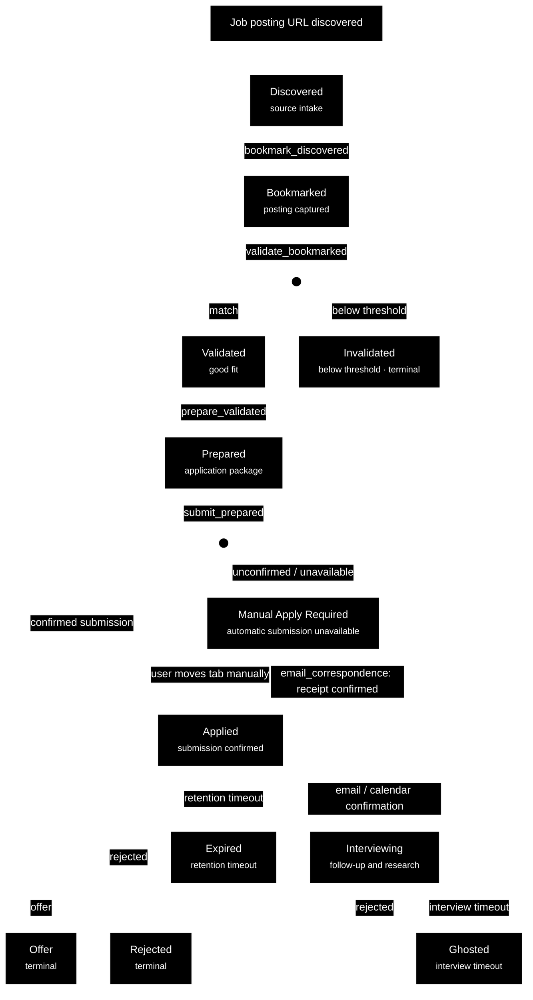

# AJSS — AI Job Search System

AJSS is an AI-assisted job-search workflow whose state lives in Google Docs tabs and whose transitions are committed by one deterministic orchestrator.

## Architecture

**[Architecture diagrams — components, queue sequence, states, storage and deployment](docs/architecture.md)** are maintained in Mermaid and rendered on GitHub.

Posting URLs placed in the `Discovered` tab start the lifecycle. Discovery source scheduling is not part of the worker.

## Run locally

Ask Codex or Grok to run the system locally, or follow [docs/local-run.md](docs/local-run.md). `make onboard` is safe to repeat. It names the one missing piece and prints links for Google, Drive, the interviews journal, Neon, and the cover-letter key. The worker starts only after that checklist is ready and you agree, because the first start adds queue tabs to the journal.



`Auto` means system-driven; `User` means manual action; `Auto / User` means either can cause the transition.

| State | What happens | Transition actor |
| --- | --- | --- |
| `Discovered` | AJSS records the posting as a new candidate item. | Auto |
| `Bookmarked` | `bookmark_discovered` fetches and records the posting details. | Auto |
| `Validated` | `validate_bookmarked` confirms that the posting matches the candidate profile. | Auto |
| `Invalidated` | The posting is below the matching threshold and becomes terminal. | Auto |
| `Prepared` | `prepare_validated` creates the tailored application package and submission materials; automatic submission may lead to `Applied` or `Manual Apply Required`. | Auto |
| `Manual Apply Required` | Automatic submission was unavailable or unconfirmed; the user can move the tab to `Applied`, or `email_correspondence` can advance it after detecting a confirmed receipt. | Auto |
| `Applied` | `submit_prepared` records a confirmed application submission. | Auto / User |
| `Expired` | The application remains inactive past the retention timeout. | Auto |
| `Interviewing` | Email and calendar signals confirm an interview or follow-up activity. | Auto / User |
| `Offer` | The candidate receives a confirmed offer. | Auto / User |
| `Rejected` | The application reaches a confirmed rejection outcome. | Auto / User |
| `Ghosted` | Interview-stage activity remains unanswered past the retention timeout. | Auto |

### AJSS at a glance

| Area | Responsibility |
| --- | --- |
| Google Docs tabs | The live application queues and workflow state |
| GDTQ | The tab-queue abstraction: `pop(A)` → `A-onFlight` → `push(A,B,…)` |
| Orchestrator | Validates typed outcomes, routes transitions, and commits state |
| Google Drive | Applicant materials, resumes, application packages, and completion artifacts |
| Neon PostgreSQL | Identities, leases, idempotency, and scheduler checkpoints |

GDTQ keeps each application's tab URL stable while moving it between parent state tabs. Agent outcomes are defined by JSON Schemas in `schemas/` and routed by `config/gdtq-routing.json`.

The Google Docs client, Drive artifact store and OAuth helpers live under `adapters/google/`; ATS/API/scraping adapters under `adapters/job_boards/`; the OpenAI provider under `adapters/llm/`. AJSS's GDTQ runner and PDF generator are self-contained.

## Local setup

Requires Docker Compose. The live worker additionally needs a Google Docs journal and Drive root, a résumé PDF accessible in Drive, and OAuth credentials. Onboarding writes `Applicant/applicant_profile.json` from that PDF.

Build the development image and run the deterministic checks inside it:

```bash
make setup
make verify
```

Individual checks are also available:

```bash
make doctor
make test
```

Run `make setup` again whenever dependencies or the Dockerfile change. No host Python installation or virtual environment is required. `make run` starts the worker through Docker Compose.

Configure a Google access token or refresh-token credential set using environment variables documented in `adapters/google/README.md`. Run onboarding with the existing Drive directory URL. It reuses the specified queue document, or an exact-title `AJSS Main Queue` document already in that directory; if neither is supplied/found, it creates one there. It also creates the `Applications` subdirectory, provisions missing queue tabs, and writes ignored `config/runtime.json`:

```bash
make bootstrap BOOTSTRAP_ARGS='--drive-root-url https://drive.google.com/drive/folders/YOUR_FOLDER_ID --queue-document-url https://docs.google.com/document/d/YOUR_DOC_ID/edit'
```

Omit `--queue-document-url` to reuse or create the exact-title `AJSS Main Queue` document. To use another name for lookup/creation, pass `--queue-document-title`. The selected Docs file must be a direct child of the configured Drive directory. Configure the resume path, `AJSS_LLM_PROVIDER`, and `AJSS_LLM_API_KEY`, then run one process:
```bash
make run
```

**Do not enable against a production journal before validating tab movement on a test document.** Live browser submissions require authorized injectable browser/API strategies; the CLI does not perform them by default. Optional mail/calendar/research/report integrations are behind `AJSS_GDTQ_ENABLE_OBSERVERS=1`, and Gmail send is disabled without `AJSS_GMAIL_ALLOW_SEND=1`.

For containers, see [deployment](deployment/README.md). For **on-demand ChatGPT/MCP access on Vercel**, use [Vercel gateway instructions](deployment/VERCEL.md). The authenticated service exposes read-only history/dedup tools; dispatch is separately disabled until live integration is approved. Full queue contract, recovery policy and limitations: [AJSS runtime](ajss/README.md). State map: [config/gdtq-routing.json](config/gdtq-routing.json).

## Repository

| Location | Purpose |
| --- | --- |
| `ajss/` | Python package. `queue/` is the tab queue the worker moves, `worker/` is the running process, `onboard/` is the operator checklist, `documents/` builds the profile and cover letter, `submission/` runs at submit time, and `cli.py` is the entry point |
| `adapters/google/` | Google OAuth, Docs tab operations, Drive artifact store and journal readers |
| `adapters/job_boards/` | ATS APIs, parsing, scraping and submission response contracts |
| `adapters/google_events.py` | Read-only Gmail and Calendar event sources |
| `adapters/llm/openai_provider.py` | OpenAI-compatible model provider |
| `agents/application/`, `agents/interview-prep/` | Prompt and schema assets for AI stages |
| `config/gdtq-routing.json`, `schemas/` | State graph and exhaustive typed business outcomes |
| `tests/` | Deterministic unit and adapter-boundary tests |
| `deployment/` | AJSS Docker images and operator guide |

## Safety and correctness

Submission attempts are checkpointed before external actions; uncertain results require reconciliation instead of another click. Completed applications are archived in Drive and read back before deletion from Docs. Google Docs writes and SQLite commits do not form a distributed transaction: use one writer, an operator recovery policy, and backups for the SQLite identity index.

## Existing Neon history

The existing `ajss-db` contains 160 applications and 240 historical posting keys; 46 applications were missing any key. See [the idempotent Neon migration](sql/gdtq/README.md), which preserves the legacy tables and backfills the new GDTQ index. Set `DATABASE_URL` to activate the PostgreSQL implementation. **Migration applied and verified in Neon main on October 27, 2026**: 160/160 applications covered, 369 keys, all 240 original keys preserved. The production worker is not yet deployed.
