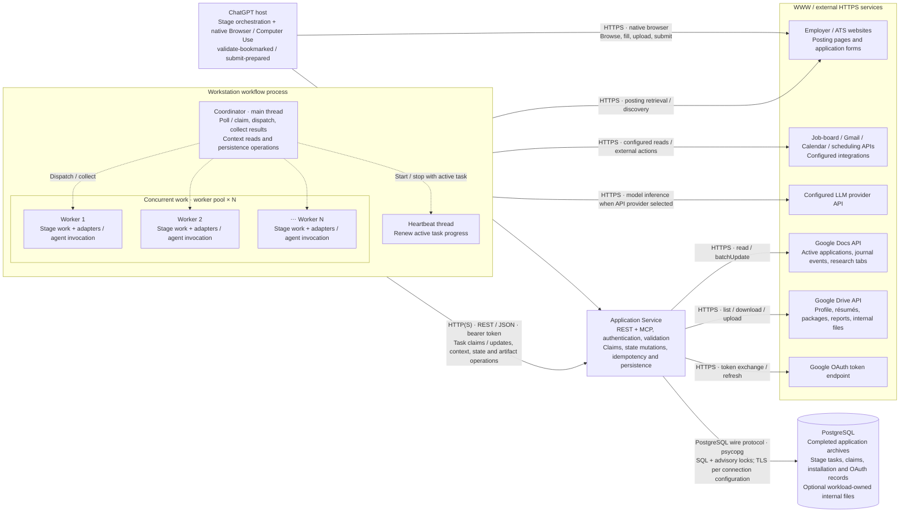

# Runtime communication — concurrency view

An experimental simplification of the [original architecture diagram](architecture.md#process-boundaries-and-network-communication).
Within our system, boxes represent execution hosts or independently running work.
The repeated worker boxes represent a pool; **N is configuration-dependent**, not
three fixed workers. Adapters, agent runners, executors and HTTP clients are
folded into the execution lanes that call them.

Solid arrows are network requests; responses return over the same connection.
Dotted arrows are local dispatch or lifecycle coordination. Network arrows from
the workstation boundary aggregate calls made by its execution lanes through
the shared synchronized client; that client is not a separate thread or service.

The coordinator and worker pool show the concurrency shape, rather than promising
that every stage uses every lane. Sequential stages execute in the coordinator;
parallel-capable execution uses the pool. Heartbeats run while a workstation
stage task is active. The deployment selects its executor; this diagram does not
propose running competing registry writers or the legacy queue utility alongside
the active executor. Native-browser stages remain exclusively in ChatGPT.

An API-backed agent invocation runs within its calling lane. A CLI-backed
invocation can launch a child process, but is folded into the worker because the
caller waits for its result. Agents receive serialized context and return
validated decisions; they have no persistence or external-system clients.
The Application Service's handlers and repositories are likewise collapsed into
one deployment box; its internal request concurrency is outside this view.

Only the Application Service accesses persistence during stage execution.
The workflow polls it for work; there is no service-to-workstation push channel.
Production uses HTTPS; local REST defaults to `http://127.0.0.1:8080`.
