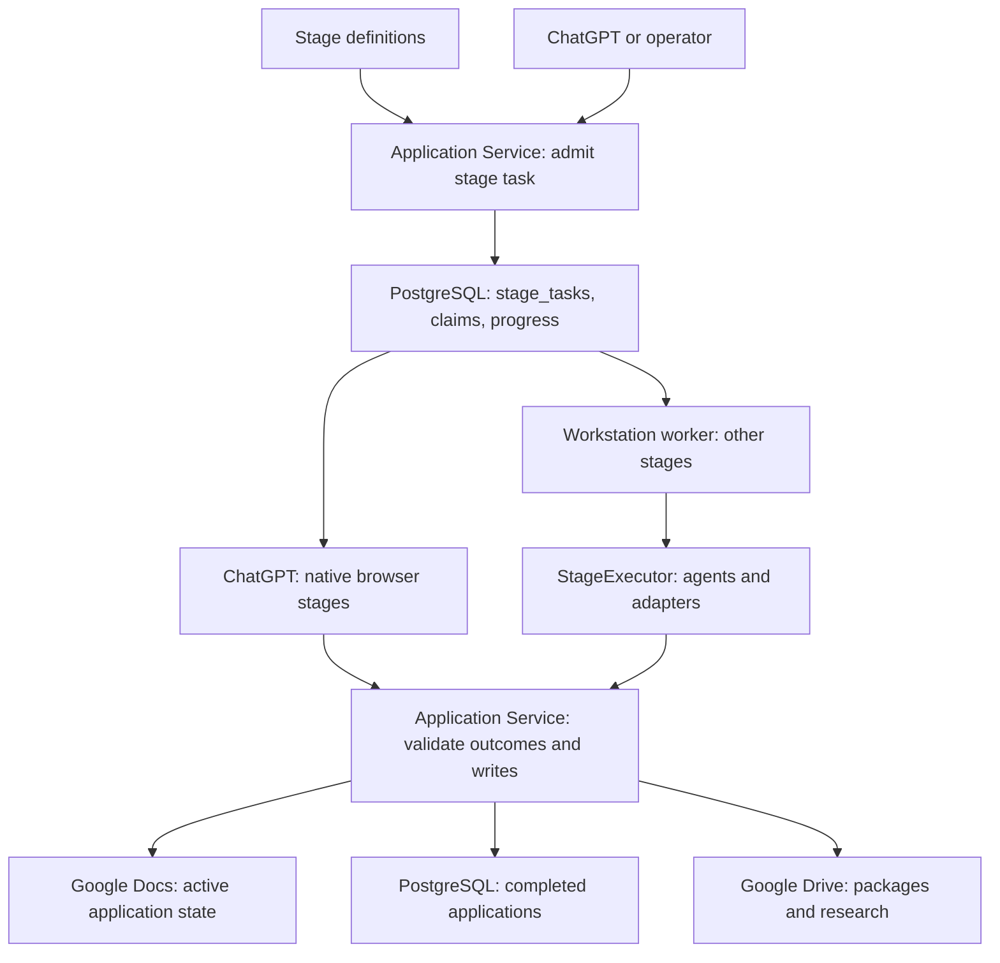

# Workflow, stage and task architecture

A **workflow** is the coordinated job-search lifecycle. A **stage** is one
processing definition in `stages/*.yaml`. A **stage task** requests execution
for a stage and a scope. A **worker** executes tasks. An **agent run** invokes a
stateless decision agent. These are different concepts, not interchangeable names.

## Persistence responsibilities

| Data | Authoritative store |
| --- | --- |
| In-progress applications, states and journal events | Google Docs application journal |
| Completed application archives and completed-posting deduplication | PostgreSQL relational tables |
| Execution commands, claims, task progress and report references | PostgreSQL `installation_resources.stage_tasks` |
| Installation metadata and OAuth coordination | PostgreSQL `installation_resources` |
| Résumé, generated packages and configured artifacts | Google Drive |

A queued stage task is a command, not a job application. One task can discover
new positions, process several application IDs from the journal, or run a
maintenance stage with no application IDs. Task status (`queued`, `running`,
`succeeded`, `failed`, `reconciliation_required`) is separate from application
status (`Discovered`, `Bookmarked`, `Prepared`, etc.). Neither is inferred from
the other's queue size.

## Source and API contracts

`services.stage_definitions` parses stage definitions. Polling and event routing
create workload envelopes with a `stage` field. `services.stage_executor.StageExecutor`
claims and executes them through the Application Service boundary. Its
implementation lives in that module, without alternate class or import names.

`application_service.stage_tasks.StageTasks` owns durable command admission,
scope snapshots, claims and monitoring. It stores requests under `stage_tasks`.
The canonical routes are `/stages`, `/stages/execution`, `/stages/readiness` and
`/stage-tasks`. Requests use `stage`; commands are identified by `stage_task_id`.
List responses contain `tasks` and `next_cursor`.

MCP tools are generated from `openapi.yaml`, including `listStages`,
`startStageTask`, `listStageTasks`, `getStageTask`, `getStageTaskReport`,
`nextChatGPTStageTask` and the browser-result tools. `AJSS_MCP_TOOL_PROFILE=stages`
selects operational task tools and related reads; `domain` adds state operations.

## Execution ownership

`validate-bookmarked` and `submit-prepared` execute in ChatGPT's native browser.
The hosted Python service supplies task context and validates observed results;
it never launches a browser or delegates these interactions to a workstation.
The other stages use the separately activated workstation worker in this source.
Hosting the HTTP API on Vercel does not create an execution worker.

`AJSS_STAGE_TASKS_ENABLED=1` admits commands and enables native-browser stages.
`AJSS_WORKSTATION_STAGES=1` enables workstation claims. Agent selection and
consumer counts remain deployment configuration. Polling follows stage triggers
and input states; YAML filenames do not specify execution order.

A running claim is never automatically retried after uncertainty. A native
browser submission records an intent before its final submit click. Interrupted
or uncertain execution requires inspection before reconciliation; maintenance
and reporting failures can also require reconciliation. The status alone does
not prove an application was submitted.

See [application state machines](state-machines.md),
[ChatGPT operations](../deployment/chatgpt-stages.md), and
[the coordinated cutover](stage-task-cutover.md).
