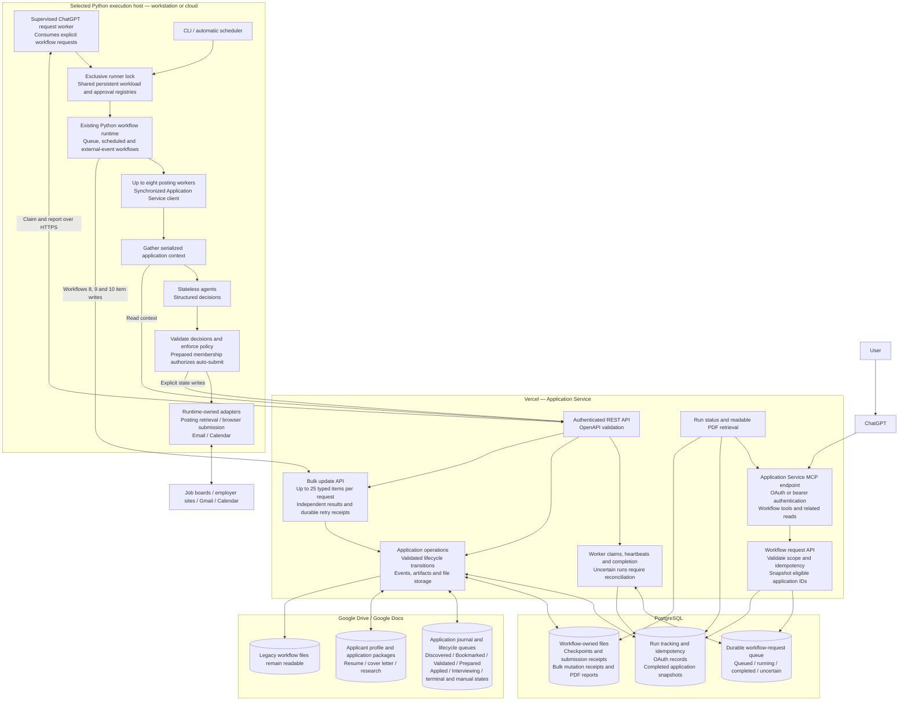
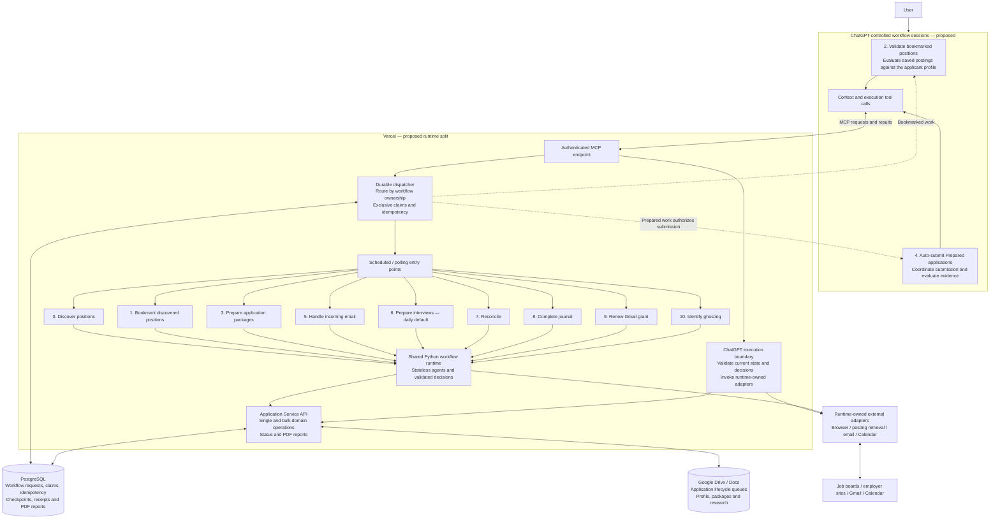
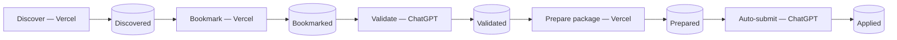

# Workflow execution architecture

See [state machines](state-machines.md) for lifecycle transitions and execution tracking.

## Current implementation

ChatGPT starts and monitors workflows through MCP. Python workflow execution
runs on the configured workstation worker. The same runtime can also be hosted
on a cloud process/container host. A CLI or continuous scheduler is another
entry point; choose one registry-writing runner for an installation.

The workflow-request queue in PostgreSQL holds requests to execute work. The
application queues in the journal describe posting lifecycle states. The host's
workload and approval registries track execution bookkeeping. These are distinct
responsibilities.

The workflow-only MCP profile exposes execution requests and relevant reads.
The domain profile additionally exposes direct domain operations, including
`bulkUpdateItems`. Internal claim and worker-update endpoints are excluded from
MCP. Agents receive serialized context and return decisions; runtimes own tool
calls and adapter execution. Application state changes belong to the Application
Service.

Bulk updates validate the whole request schema and return per-item outcomes;
they are not a distributed all-or-nothing transaction. Durable intents prevent
blind retries of uncertain mutations. Workflows 8 and 10 batch completion and
removal operations; workflow 9 uses bulk grant installation and acknowledgement.

Automatic `prepare-interview` polling defaults to 86400 seconds, configurable
through `pipelines.interview.event_poll_seconds`. It polls at scheduler startup
and every 24 hours afterward; restarting the scheduler resets that timer.
Explicit CLI and ChatGPT requests remain on demand. The request worker itself
does not activate a continuous automatic scheduler.

## Proposed execution split

This is a proposed redesign, not the current deployment. Nine workflows would
execute in Vercel, and ChatGPT would own validation and auto-submit workflow
sessions. Hosting those nine runtimes in Vercel and implementing the ChatGPT
execution boundary require additional work. MCP supplies tools; it does not
move Python execution into a chat session automatically.

In that proposed split, the main pipeline crosses execution environments:

Browser actions still need an execution adapter, and persistent writes still
pass through the Application Service. ChatGPT owns the two workflow sessions;
MCP connects those sessions to the execution capabilities.

## Execution migration prerequisites

The requested ownership is: **ChatGPT: validate-bookmarked and submit-prepared;
Vercel: the other nine workflows**. This supersedes the earlier proposal that
placed bookmarking in ChatGPT. Publishing the API does not activate this split.

The production API/MCP endpoint is deployed. Its existing worker still runs
Python workflows on the workstation. Before changing execution ownership:

- Replace local Codex/Grok CLI providers with an API-backed provider for hosted
  agent workflows. No model API credential was configured in the Vercel
  production environment at the migration inspection. Configure credentials
  directly in Vercel, never in committed files or chat.
- Implement bounded hosted execution, persistent workload/approval registries,
  exclusive claims across hosts, and durable continuation beyond a function's
  deadline. The existing workstation worker must not be moved unchanged into
  an HTTP function. Configure Vercel scheduling separately from deploying MCP;
  preserve the daily prepare-interview default.
- Provide a portable original résumé through the Application Service. The
  current profile's source_resume.path refers to an absolute workstation file.
  Keep private runtime configuration and applicant data out of deployment source.
- Implement ChatGPT execution-session tools that provide serialized context and
  the deployed agent contract, validate returned decisions, check current state,
  and apply the same workflow logic. Existing startWorkflow only enqueues work
  for the workstation worker; it does not execute decisions in ChatGPT.
- Connect a hosted browser adapter for submissions. The default adapter uses
  local Node/Playwright/Chrome. ChatGPT orchestration still needs a runtime-owned
  execution adapter; preserve durable pre-submission receipts and never retry
  an uncertain attempt automatically.

Until those changes are implemented and verified, the current-implementation
diagram above describes execution. The split diagram describes the requested
target, not a completed migration.
