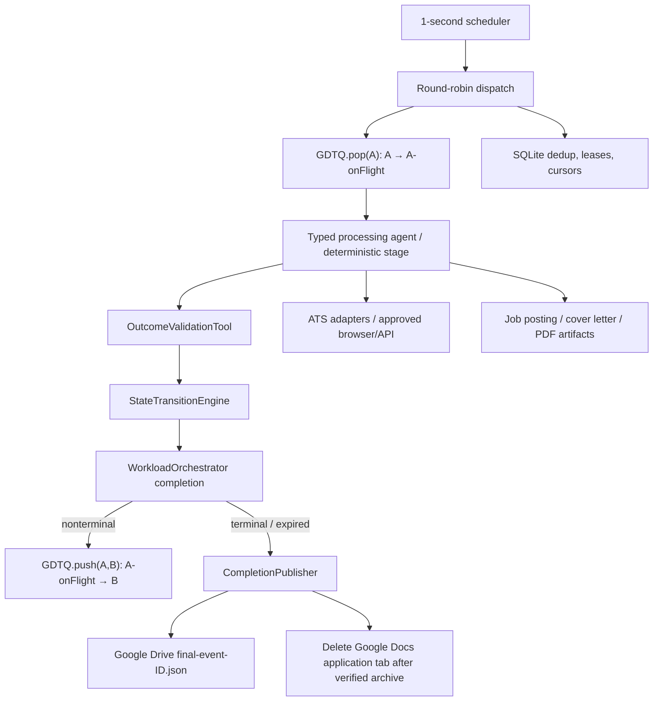

# Architecture — GDTQ

This document describes the **target architecture** on the GDTQ feature branch. The old stage-task diagram is superseded. `application_service/` and deployment tooling remain for compatibility and shared primitives.

## Ownership

| Concern | Owner |
| --- | --- |
| Legal state transitions / outcome enum coverage | `config/gdtq-routing.json` + `gdtq.policy` |
| Active application state and event journal | Google Docs tabs through `gdtq.queue` |
| Dispatch and error recovery | `gdtq.dispatch.WorkloadOrchestrator` |
| Applicant identity/dedup and durable cursor | `gdtq.store.WorkIndex` (SQLite) |
| Application artifacts and final event history | Google Drive `Applications/` or `Failed/` |
| Deterministic stage implementations and LLM tasks | `gdtq.stages`, `gdtq.handlers` |
| Correspondence, Calendar and research | `gdtq.observers`, `gdtq.integrations` |
| Legacy API, Neon/Postgres stage tasks, old pipelines | Compatibility system (not new runtime) |

## Guarantees and limitations

Google Docs `batchUpdate` can group an event insertion and tab reparenting under the same document revision, but no cross-service transaction covers SQLite and Drive. The runtime must reconcile unfinished claims and partial archives; always use a single document writer. The 100-tab limit counts root state tabs, in-flight tabs and nested research tabs. A 90-tab soft limit triggers retention of manual items before capacity exhaustion.

The stage transition policy is a **legal-transition graph**. The per-agent outcome map resolves the next state; system-level quarantine, Failed, Expired and Ghosted are administrative/terminal policies. External email and form submission require explicit authorized adapters. The observed CI suite is deterministic, not live end-to-end certification.

See [GDTQ runbook](../gdtq/README.md), [states](state-machines.md), [storage](storage-backends.md), and [README](../README.md).
