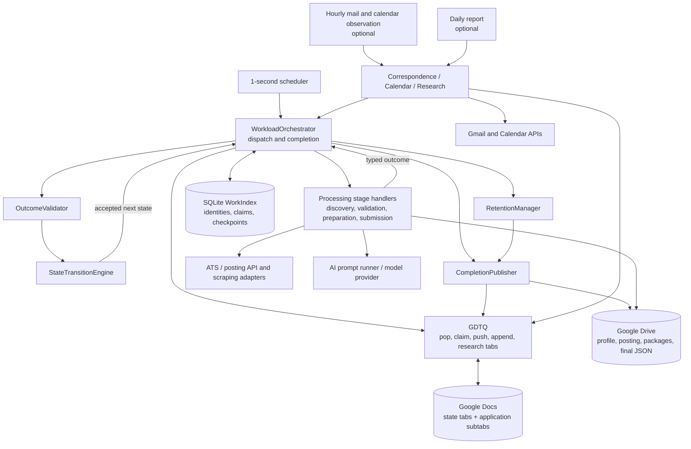
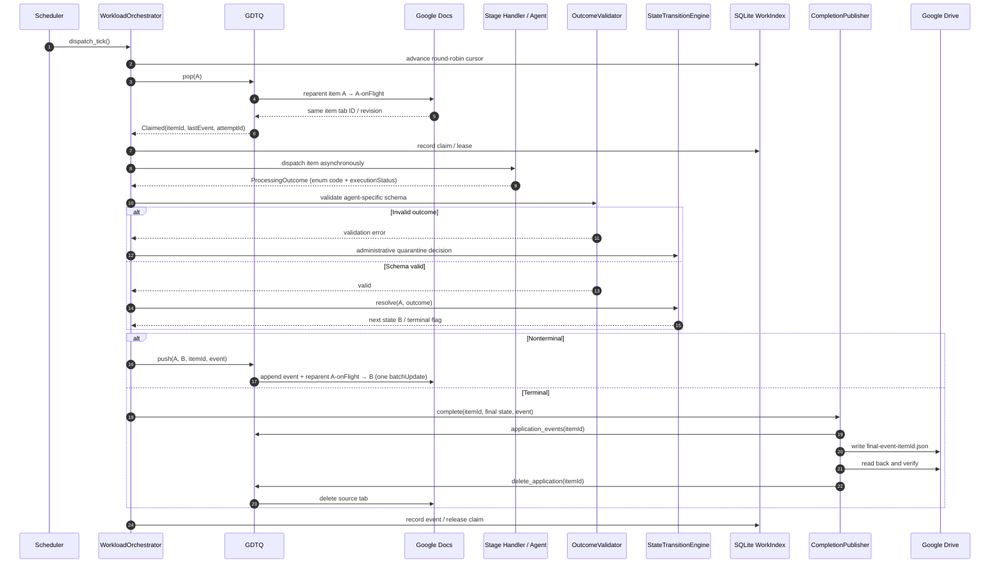
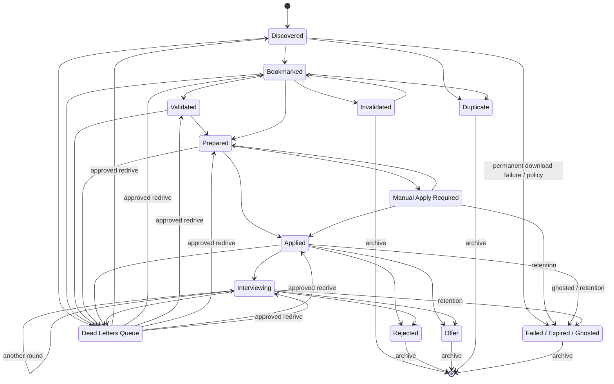
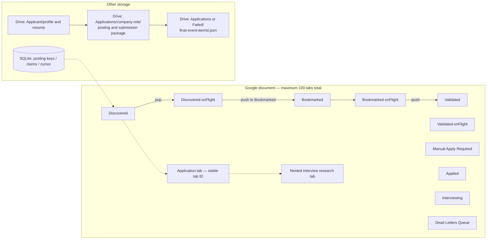
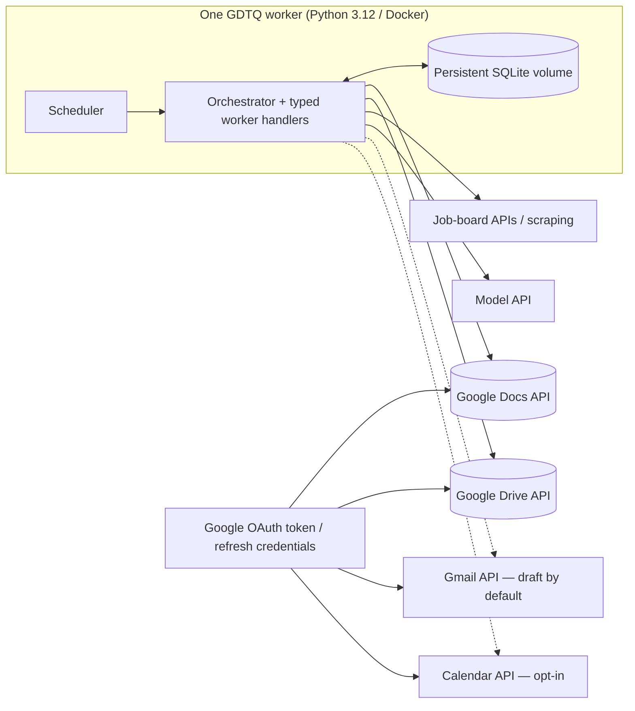

# AJSS — GDTQ architecture diagrams

These diagrams describe the **GDTQ-only branch**. They are maintained as Mermaid source and rendered directly by GitHub. The executable source of truth is the code under `gdtq/` and `adapters/`, plus `config/gdtq-routing.json` and `schemas/gdtq/`; diagrams do not define runtime behavior.

## 1. System component architecture

**Ownership:** agents and adapters report results; the orchestrator initiates state changes. `OutcomeValidator` and `StateTransitionEngine` are deterministic policy components. `CompletionPublisher` archives and verifies before deleting the active application tab.

## 2. Queue processing and completion sequence

The in-flight tab is **always owned by the source queue**. No `B-onFlight` hop occurs during `push(A,B,...)`. SQLite, Docs and Drive are separate stores: their changes are not a single distributed transaction, so recovery/reconciliation is required.

## 3. Application states and administrative terminal outcomes

The following diagram emphasizes the primary lifecycle and exceptional routing. For **every** permitted transition, including DLQ redrive and `Invalidated → Bookmarked`, consult `config/gdtq-routing.json`.

Business-state transitions use the versioned legal graph and outcome mapping. `Failed`, `Expired`, and `Ghosted` are **administrative terminal completions**, not ordinary agent-selected edges. The chart intentionally omits some legal cross-stage shortcuts to remain readable.

## 4. Google Docs tab hierarchy and durable stores

The fixed hierarchy diagram is **illustrative**, not a complete enumeration of current queue contents or every allowed reparent. Each application is a direct child of exactly one state or in-flight tab at a time. Its nested research tabs move with it. All root, application, in-flight and research tabs count toward the document limit.

## 5. Runtime deployment and external integrations

There is **no Application Service, REST/MCP server, PostgreSQL service or alternate stage-task runner** in this deployment. Live Google integration, browser submission and external send permissions still require explicit configuration and testing.

## Maintenance rule

When changing `gdtq/queue.py`, `dispatch.py`, `downstream.py`, `retention.py`, `config/gdtq-routing.json`, or deployment boundaries, update the relevant diagram in the same pull request. Keep diagrams architecture-level and avoid copying state policy into a second authoritative configuration.
