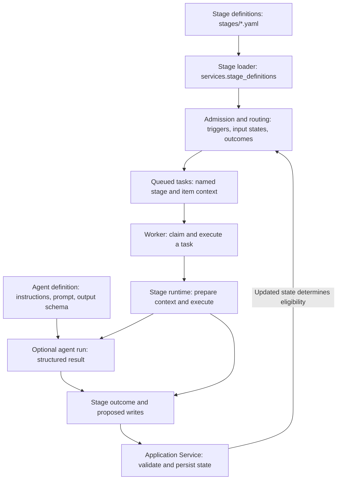
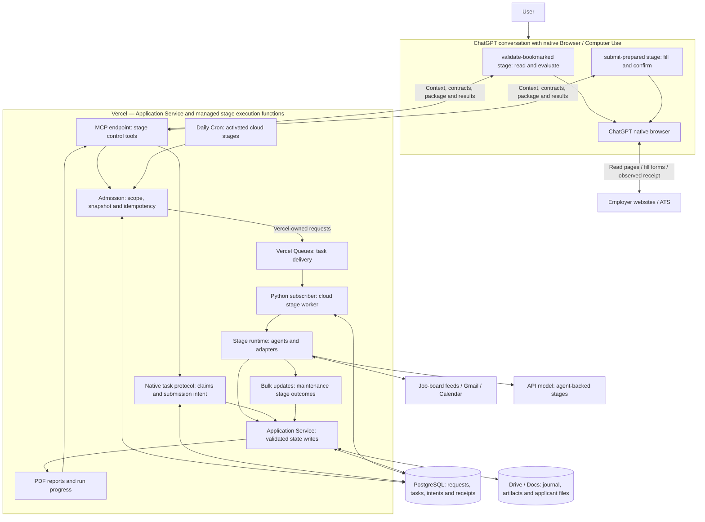
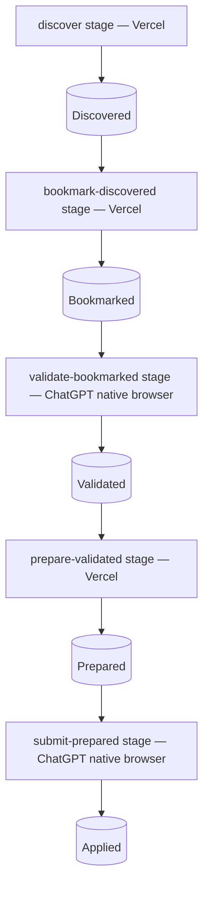
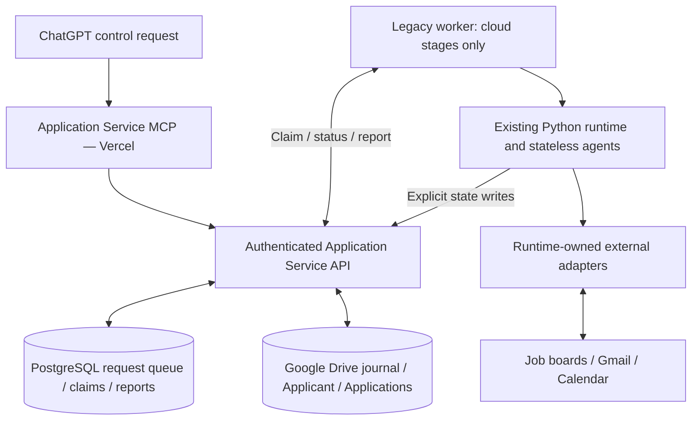

# Workflow and stage execution architecture

See [state machines](state-machines.md) for lifecycle transitions and execution
tracking, and [the ChatGPT workflow guide](../deployment/chatgpt-workflows.md)
for tools, setup and interruption handling. `listWorkflows` reports the active
execution host; `getWorkflowExecutionReadiness` reports activation prerequisites.
A deployed API does not prove that a ChatGPT browser session is available.

## Processing terminology

A **workflow** is the overall application lifecycle. A **stage definition** in
`stages/<name>.yaml` declares a trigger, input states, an optional agent, external
actions, and outcome-to-state routing. Stage filenames have no execution order;
triggers and application states determine eligibility. Stage-specific dependencies
live under `stages/<name>/requirements.txt`.

`services.stage_definitions` loads these definitions. A **worker** executes queued
**tasks** for stages; the **orchestrator** allocates consumers and routes results.
An **agent definition** is the reusable source directory containing its prompt
and output contract; an **agent run** is one invocation.

Existing API names, configuration keys and durable records using `workflow`
remain compatible. They identify the same named stage when referring to an
individual operation. The old discovery/parser imports in `services.test_runner`
remain compatibility aliases; runtime code uses the stage definition module.

## Definition and execution boundaries

These are logical boundaries shared by the host-specific paths below. A stage
is a reusable processing definition; a worker is execution capacity and can
process tasks for multiple stages. The YAML list does not imply one dedicated
process per stage. Agent-free stages execute deterministic handlers or adapters.
Native-browser stages use the ChatGPT task protocol for website interaction.
The standalone orchestrator also has a separate live consumer/routing configuration
in `config/pipelines.json`; renaming the YAML directory did not merge those paths.

## Native ChatGPT browser and Vercel execution

The implemented split assigns website reading/match validation and form submission
to ChatGPT's **own native browser**. MCP supplies context and records structured
results; it does not launch a separate browser. The other nine stages have a
Vercel Queues execution path. Cloud activation is explicit; until enabled and configured, those nine stages wait
without executing. There is no implicit workstation fallback. The two
native-browser stages are never claimed by a workstation worker.

The browser-to-website arrows are inside the ChatGPT execution path. Vercel checks
contracts, current state, package hashes and retry semantics; it does not itself
observe those webpages. ChatGPT reports what its native browser observed. No
workstation browser, remote browser, Playwright process or API model substitutes
for either of those two website stages.

Bookmarking on Vercel only moves discovered links into Bookmarked. It does not
need to read a potentially blocked employer site before ChatGPT can inspect it.
ChatGPT validation saves the complete posting artifact and applies the existing
validation/completion planner. Preparation subsequently reads that saved artifact
and the original résumé through the Application Service.

The PostgreSQL request queue represents requests to run workflows. The journal's
state queues group applications by lifecycle state. Vercel Queues delivers
independent execution units. These are separate responsibilities.

## Main workflow across hosts

## Stage execution ownership

| Host | Stages |
| --- | --- |
| ChatGPT native browser | `validate-bookmarked`; `submit-prepared` |
| Vercel when activated | `discover`; `bookmark-discovered`; `prepare-validated`; `handle-incoming-email`; `prepare-interview`; `reconcile`; `complete-journal`; `renew-gmail-grant`; `identify-ghosting` |

Cloud execution needs its configured model credentials for agent work, a portable
résumé from applicant onboarding, working artifact creation, and explicit
`workflow_execution.vercel_enabled` activation. The supplied Vercel Cron is daily
at 05:00 UTC and preserves daily interview preparation. Hobby does not provide
minute Cron; preserving minute polling requires a suitable plan and Cron change.
A native ChatGPT session remains on demand. Check live readiness instead of
assuming that shipping this source activates every dependency.

## Legacy workstation compatibility

This earlier architecture is available only with the explicit
`AJSS_LEGACY_WORKSTATION_WORKFLOWS=1` compatibility setting. It is disabled by
default; disabling Vercel does not activate it. It is not how native ChatGPT browser tasks execute.
Only one registry-writing runner should be used for an installation.

All persistence paths retain the Application Service boundary. Bulk changes are
ordered independent operations with per-item results, not one distributed
transaction. A durable intent or submission with an unknown outcome is never
blindly retried. Native-browser pauses preserve the task for specific CAPTCHA,
sign-in, upload or host-capability interaction; they do not add a Prepared queue
approval gate or promise successful CAPTCHA handling on every website.

## Drive file creation

The service account reads and edits the selected Drive directory. For new My
Drive files/folders, the existing `drive.file` owner grant creates app-owned
items and moves them into that directory; inherited sharing then permits
service-account reads and updates. PostgreSQL allocates file IDs before create,
so retries use the same ID even after a lost response. No broader Drive scope
is requested. Live temporary probes verified folder/file creation, read/write
and stable IDs on replacement; probe items were trashed afterward.
