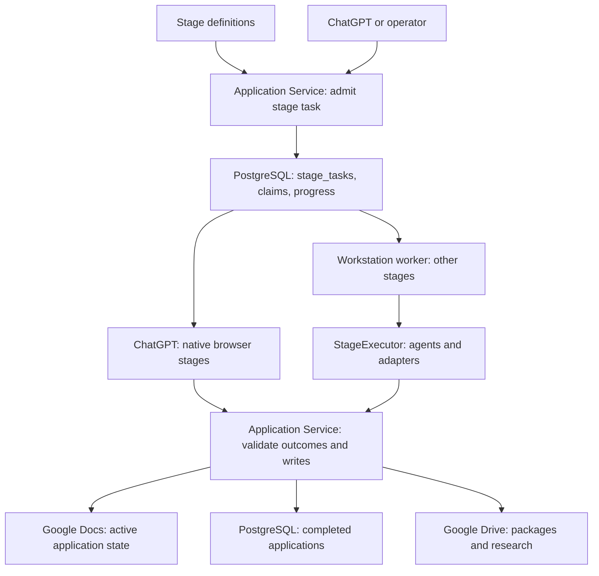
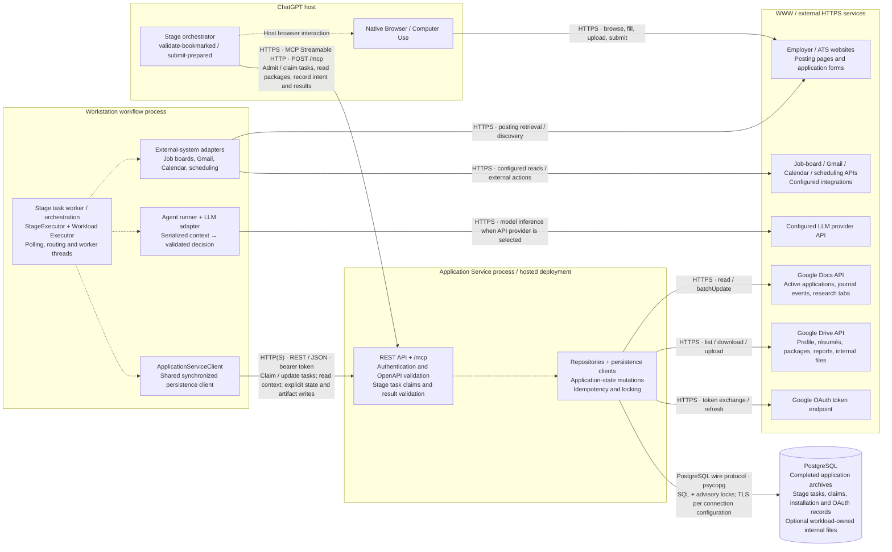

# Stage and task architecture

A **pipeline** spans the job-search lifecycle. A **stage** is one
processing definition in `stages/*.yaml`. A **stage task** requests execution
for a stage and a scope. A **worker** executes tasks. An **agent run** invokes a
stateless decision agent. These are different concepts, not interchangeable names.

## Persistence responsibilities

| Data | Authoritative store |
| --- | --- |
| In-progress applications, states and journal events | Google Docs application journal |
| Completed application archives and completed-posting deduplication | PostgreSQL relational tables |
| Execution commands, claims, task progress and report references | PostgreSQL `installation_resources.stage_tasks` |
| Installation metadata and OAuth coordination | PostgreSQL `installation_resources` |
| Résumé, generated packages and configured artifacts | Google Drive |

**Important:** Incomplete applications (those in `Discovered`, `Bookmarked`,
`Validated`, `Prepared`, or `Manual Apply Required` states) exist **only** in
Google Docs and Google Drive. PostgreSQL stores **only** completed applications
as archives. The database never holds in-progress application state.

A queued stage task is a command, not a job application. One task can discover
new positions, process several application IDs from the journal, or run a
maintenance stage with no application IDs. Task status (`queued`, `running`,
`succeeded`, `failed`, `reconciliation_required`) is separate from application
status (`Discovered`, `Bookmarked`, `Prepared`, etc.). Neither is inferred from
the other's queue size.

## Process boundaries and network communication

This diagram focuses on runtime communication. Boxes group components by execution
host; components inside a box are not separate network services. Solid arrows
show network requests initiated by the source (responses return on the same
connection). Dotted arrows show local calls or subprocess IPC. External APIs and
websites are grouped under WWW; PostgreSQL uses its own wire protocol.

The workflow initiates REST requests; the service does not push work to it.
`POST /stage-tasks/claim` polls for commands and worker updates report progress.
ChatGPT uses the same service boundary through MCP for task context and structured
browser results. The REST contract is [`openapi.yaml`](../openapi.yaml).
Production service connections use HTTPS; local development defaults to
`http://127.0.0.1:8080`.

The LLM path depends on configuration: an API adapter calls the provider over
HTTPS, while a CLI adapter launches a local agent subprocess using prompt/schema
files and structured output. Stateless decision agents receive no persistence,
browser, Gmail or Calendar clients. Website validation and submission for the two
native-browser stages always run in ChatGPT's native browser.

Google Docs and Drive are persistence dependencies even though their transport
is HTTPS over the public internet. Only the Application Service accesses those
stores during stage execution. PostgreSQL stores task coordination separately
from completed application archives; active applications remain in the Docs
journal. Workload-owned internal files can optionally use PostgreSQL behind the
same service API. Setup/provisioning and local configuration/log files are outside
this runtime diagram.

### Boundary rules

- **Agents** receive only serialized context and return schema-validated decisions. They never receive adapter or persistence clients.
- **Workers** are stateless threads that invoke agents and return results. They never touch the persistence API.
- **Stage Executor** is the lifecycle boundary between queued workloads and stateless stage execution.
- **Workload Executor** is the side-effect boundary that translates agent decisions into Application Service operations.
- **Application Service** is the only component that communicates with storage layers (Google Drive, Google Docs, PostgreSQL). Every write is explicit, validated, and idempotent where retries are possible.
- **Adapters** normalize inputs from external systems and perform only their assigned external action.

## Source and API contracts

`services.stage_definitions` parses stage definitions. Polling and event routing
create workload envelopes with a `stage` field. `services.stage_executor.StageExecutor`
claims and executes them through the Application Service boundary. Its
implementation lives in that module, without alternate class or import names.

`application_service.stage_tasks.StageTasks` owns durable command admission,
scope snapshots, claims and monitoring. It stores requests under `stage_tasks`.
The canonical routes are `/stages`, `/stages/execution`, `/stages/readiness` and
`/stage-tasks`. Requests use `stage`; commands are identified by `stage_task_id`.
List responses contain `tasks` and `next_cursor`.

MCP tools are generated from `openapi.yaml`, including `listStages`,
`startStageTask`, `listStageTasks`, `getStageTask`, `getStageTaskReport`,
`nextChatGPTStageTask` and the browser-result tools. `AJSS_MCP_TOOL_PROFILE=stages`
selects operational task tools and related reads; `domain` adds state operations.

## Execution ownership

`validate-bookmarked` and `submit-prepared` execute in ChatGPT's native browser.
The hosted Python service supplies task context and validates observed results;
it never launches a browser or delegates these interactions to a workstation.
The other stages use the separately activated workstation worker in this source.
Hosting the HTTP API on Vercel does not create an execution worker.

`AJSS_STAGE_TASKS_ENABLED=1` admits commands and enables native-browser stages.
`AJSS_WORKSTATION_STAGES=1` enables workstation claims. Agent selection and
consumer counts remain deployment configuration. Polling follows stage triggers
and input states; YAML filenames do not specify execution order.

A running claim is never automatically retried after uncertainty. A native
browser submission records an intent before its final submit click. Interrupted
or uncertain execution requires inspection before reconciliation; maintenance
and reporting failures can also require reconciliation. The status alone does
not prove an application was submitted.

See [application state machines](state-machines.md),
[ChatGPT operations](../deployment/chatgpt-stages.md), and
[the coordinated cutover](stage-task-cutover.md).

## Job-board access

`adapters.job_boards.framework` is the service entry point for searching, listing,
retrieving postings and dispatching native-host submission. Provider adapters own
URLs and parsing; a shared HTTP transport applies the configured API and scraping
strategies. Read failures fall back from API to scraping under one deadline.
Submission invokes the native host once, outside the read retry engine.

See [job-board framework](job-board-framework.md) for the interface, default and
per-board configuration, proxy behavior and supported capabilities.
