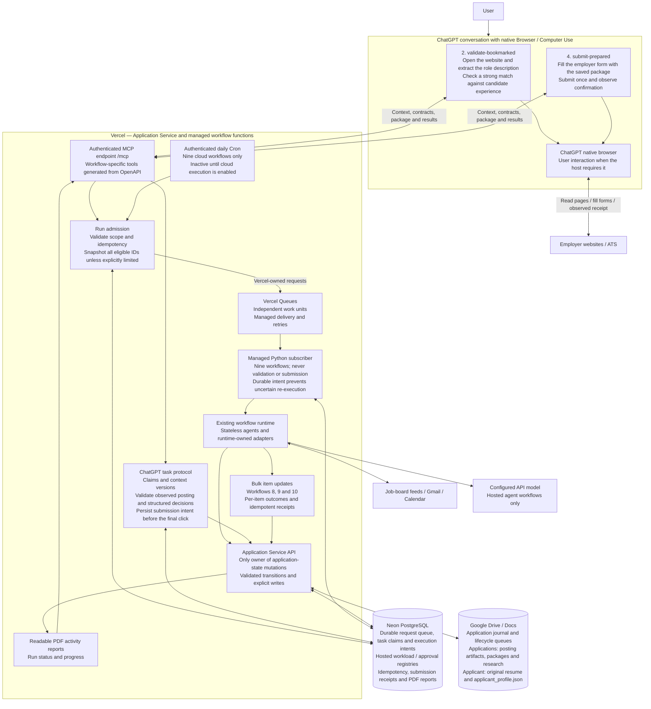
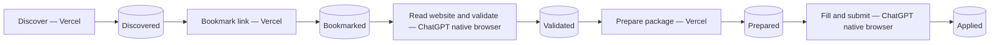
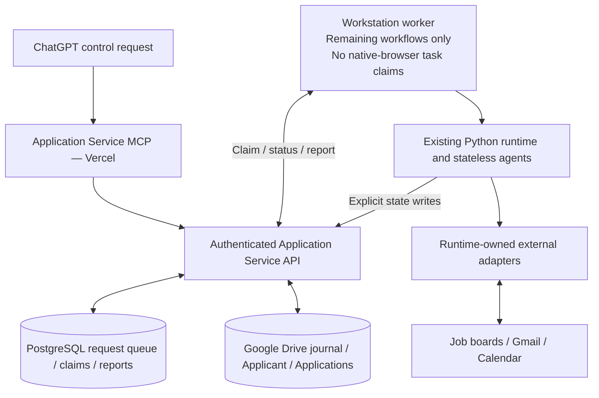

# Workflow execution architecture

See [state machines](state-machines.md) for lifecycle transitions and execution
tracking, and [the ChatGPT workflow guide](../deployment/chatgpt-workflows.md)
for tools, setup and interruption handling. `listWorkflows` reports the active
execution host; `getWorkflowExecutionReadiness` reports activation prerequisites.
A deployed API does not prove that a ChatGPT browser session is available.

## Native ChatGPT browser and Vercel execution

The implemented split assigns website reading/match validation and form submission
to ChatGPT's **own native browser**. MCP supplies context and records structured
results; it does not launch a separate browser. The other nine workflows have a
Vercel Queues execution path. Cloud activation is explicit; until enabled and configured, those nine wait
without executing. There is no implicit workstation fallback. The two
native-browser workflows are never claimed by a workstation worker.

The browser-to-website arrows are inside the ChatGPT execution path. Vercel checks
contracts, current state, package hashes and retry semantics; it does not itself
observe those webpages. ChatGPT reports what its native browser observed. No
workstation browser, remote browser, Playwright process or API model substitutes
for either of those two website workflows.

Bookmarking on Vercel only moves discovered links into Bookmarked. It does not
need to read a potentially blocked employer site before ChatGPT can inspect it.
ChatGPT validation saves the complete posting artifact and applies the existing
validation/completion planner. Preparation subsequently reads that saved artifact
and the original résumé through the Application Service.

The PostgreSQL request queue represents requests to run workflows. The journal's
state queues represent application lifecycle stages. Vercel Queues delivers
independent execution units. These are separate responsibilities.

## Main pipeline across hosts

## Workflow ownership

| Host | Workflows |
| --- | --- |
| ChatGPT native browser | 2 validate-bookmarked; 4 submit-prepared |
| Vercel when activated | 0 discover; 1 bookmark-discovered; 3 prepare-validated; 5 handle-incoming-email; 6 prepare-interview; 7 reconcile; 8 complete-journal; 9 renew-gmail-grant; 10 identify-ghosting |

Cloud execution needs its configured model credentials for agent work, a portable
résumé from applicant onboarding, working artifact creation, and explicit
`workflow_execution.vercel_enabled` activation. The supplied Vercel Cron is daily
at 05:00 UTC and preserves daily interview preparation. Hobby does not provide
minute Cron; preserving minute polling requires a suitable plan and Cron change.
A native ChatGPT session remains on demand. Check live readiness instead of
assuming that shipping this source activates every dependency.

## Legacy workstation compatibility

This earlier architecture is available only with the explicit
`AJSS_LEGACY_WORKSTATION_WORKFLOWS=1` compatibility setting. It is disabled by
default; disabling Vercel does not activate it. It is not how native ChatGPT browser tasks execute.
Only one registry-writing runner should be used for an installation.

All persistence paths retain the Application Service boundary. Bulk changes are
ordered independent operations with per-item results, not one distributed
transaction. A durable intent or submission with an unknown outcome is never
blindly retried. Native-browser pauses preserve the task for specific CAPTCHA,
sign-in, upload or host-capability interaction; they do not add a Prepared queue
approval gate or promise successful CAPTCHA handling on every website.

## Drive file creation

The service account reads and edits the selected Drive directory. For new My
Drive files/folders, the existing `drive.file` owner grant creates app-owned
items and moves them into that directory; inherited sharing then permits
service-account reads and updates. PostgreSQL allocates file IDs before create,
so retries use the same ID even after a lost response. No broader Drive scope
is requested. Live temporary probes verified folder/file creation, read/write
and stable IDs on replacement; probe items were trashed afterward.
