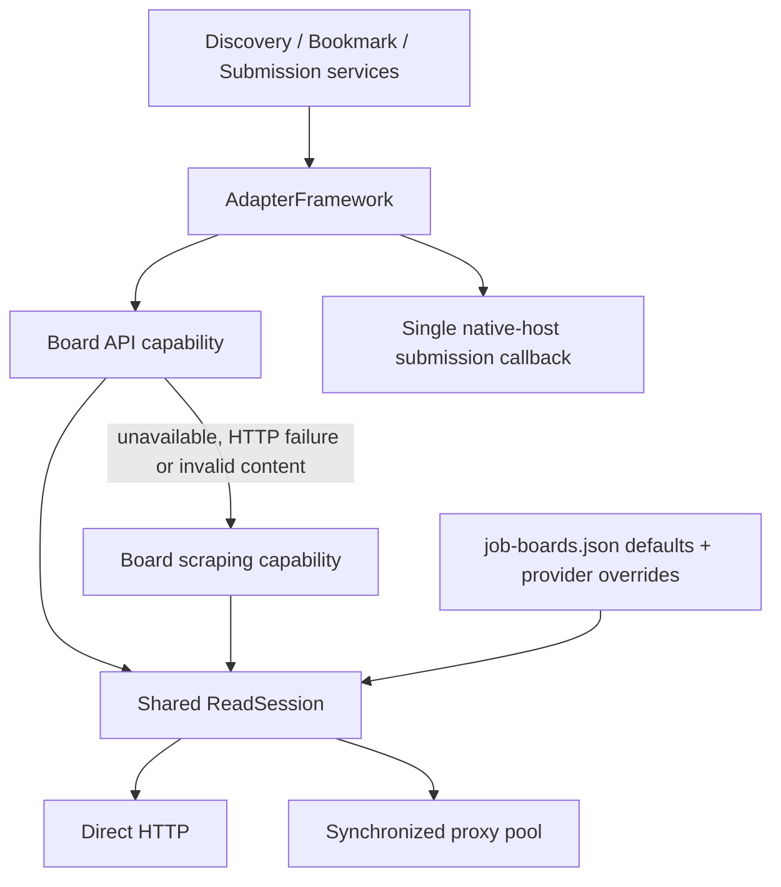

# Job-board framework

The previously generated static diagram bundle has been retired. The source-level\nflowchart below and [GDTQ architecture](architecture.md) are the maintained design references.\n\nServices use `adapters.job_boards.framework` for search, employer listing,
posting retrieval and submission dispatch. Every built-in board implements
`JobBoardAdapter`. Board classes own endpoint selection and parsing; the framework
owns transport configuration, route selection, validation and read retries.



## Capabilities and results

| Framework operation | First capability | Fallback capability |
| --- | --- | --- |
| `search(context, provider)` | `search_api` | `search_scrape` |
| `list_jobs(context, provider)` | `list_jobs_api` | `list_jobs_scrape` |
| `fetch_details(context, provider=None)` | `fetch_details_api` | `fetch_details_scrape` |
| `submit(context, provider=None)` | `submit_application` | None |

Read capabilities accept `(context, transport)` and return normalized data.
Unsupported capabilities raise `UnsupportedOperation`; an API lacking credentials
raises `MissingCredentials`. Neither consumes repeated proxy attempts. Expected
retrieval failures (`OSError`, `ValueError`, or existing adapter `RuntimeError`)
allow the next route/mechanism; unexpected programming exceptions propagate to
the stage's existing system-error handling. A successful empty API list ends the
operation. Failed parsing never masquerades as an empty list.

`AdapterResult` contains `success`, `data`, `error` and metadata identifying the
provider, mechanism, successful route and previous failed attempts. `.unwrap()`
returns the payload or raises on failure. Discovery returns a list; details return
`posting_url`, `source_url` and `description`. Details require at least 500
characters and preserve the requested posting URL separately from the final source.

```python
from adapters.job_boards.framework import get_framework
from adapters.job_boards.interface import BookmarkContext, DiscoveryContext

boards = get_framework()
postings = boards.search(
    DiscoveryContext(query='backend', countries=['IL']), 'freehire'
).unwrap()
employer_jobs = boards.list_jobs(
    DiscoveryContext(boards={'example': 'Example'}), 'greenhouse'
).unwrap()
posting = boards.fetch_details(BookmarkContext(postings[0]['posting_url'])).unwrap()
```

`discover(context, provider)` is a convenience that lists when `context.boards`
is supplied and searches otherwise. Selecting sources, employer catalogs,
profile filtering and per-employer error isolation remain service responsibilities.
The original provider `search()` / `list_jobs()` methods remain API-only compatibility
methods for direct callers; services use the framework to get fallback policy.

## Configuration

The default file is [`config/job-boards.json`](../config/job-boards.json).
Set `JOB_BOARDS_CONFIG` or pass `config_path` to select another file, or pass a
configuration dictionary as `config`. A framework instance takes a validated
snapshot; create another instance to reload it. There is no mutable global framework
whose first caller's credentials or transport settings leak into later calls.

```json
{
  "defaults": {
    "budget_seconds": 25,
    "api": {
      "backend": "urllib",
      "timeout_seconds": 6,
      "direct": true,
      "proxy_attempts": 0
    },
    "scraping": {
      "backend": "scrapling",
      "timeout_seconds": 6,
      "direct": true,
      "proxy_attempts": 4,
      "proxy_file": "free_proxies.csv",
      "impersonate": "chrome",
      "max_redirects": 5,
      "max_response_bytes": 3000000
    }
  },
  "providers": {
    "comeet": {
      "scraping": {"timeout_seconds": 10, "proxy_attempts": 2}
    },
    "greenhouse": {
      "scraping": {"direct": false, "proxy_attempts": 3}
    }
  }
}
```

Only specified provider parameters override defaults; other parameters are inherited.
API and scraping policies are independent. Both support the same HTTP backends,
timeout, direct/proxy routes, redirect and response-size limits. For example,
Chrome impersonation can be enabled for an API by setting its backend to `scrapling`.
These settings also cover requests made by provider-specific parsing methods.
Submission has no HTTP transport policy.

`budget_seconds` bounds one operation across all API and scraping attempts, including
multi-request feeds. Every request timeout is capped by the remaining deadline;
late responses are rejected. The checked-in configuration gives SmartRecruiters
120 seconds and Himalayas 60 seconds for multi-request discovery. `max_response_bytes`
is enforced during urllib reads and after the Scrapling response has downloaded.
`direct: false` requires at least one proxy attempt; missing healthy proxies produce
an explicit failure rather than an unrequested direct connection.

Relative proxy paths resolve against the configuration file's directory. Proxy CSVs
use `ip,port,globally_routable`; invalid/private endpoints are skipped and duplicate
routes removed. HTTPS targets use HTTP CONNECT with certificate verification.
Plain HTTP requests cannot use these proxy routes. API proxy attempts default to
zero, so credentialed APIs do not use the public proxy list unless explicitly
configured. Pool health and reservations are synchronized across threads, cached
per file path, and reloaded when the CSV changes. Different processes have separate
health; no pool writes application state or changes the CSV.

Legacy `POSTING_FETCH_BUDGET_SECONDS`, `POSTING_REQUEST_TIMEOUT_SECONDS`,
`POSTING_PROXY_ATTEMPTS` and `POSTING_PROXY_FILE` override defaults. The timeout
variable applies to API and scraping; proxy variables apply to scraping. Explicit
provider overrides take precedence over those default environment settings.
Unknown keys and invalid limits fail before any HTTP request.

## Supported retrieval and limits

Greenhouse, Ashby, Lever, SmartRecruiters, HiBob, Oracle (including the Akamai
alias) and Himalayas have exact-posting API readers. Comeet parses its serialized
position data. Nimble follows its published exact Comeet position URL. LinkedIn
retains its exact-job-ID mirror fallback. These rules live in their board modules,
not `posting_details.py`. Generic HTML extraction reads JobPosting JSON-LD or
explicit job-description containers; a long careers index is insufficient.

Discovery scraping reads structured JobPosting records from each provider's public
search/employer page. A provider can override `search_scrape` or `list_jobs_scrape`
for other markup or pagination. Generic scraping covers the records in those pages;
it does not claim complete pagination or render JavaScript. Pages without usable
structured records fail explicitly. Adzuna's public search mapping currently covers
GB; other countries report the missing scraping capability instead of guessing a
regional URL. Missing tokens or rate limits trigger scraping, but cannot guarantee
the site exposes usable public HTML.

Scrapling is optional: install `services/requirements-posting-fetcher.txt` or the
`posting-fetcher` project extra on workers that use that backend. The urllib
backend needs no extra dependency. Neither backend launches a browser.
`services.posting_fetcher` and `posting_details.fetch_posting_details` are compatibility
facades over the framework. `posting_details.py` otherwise contains saved-artifact
serialization and validation. Bookmarking's configured model fallback stays in
`services.bookmark_read`.

## Submission and persistence

API-first retries apply only to reads. `submit()` invokes the supplied native-host
integration exactly once, validates its structured outcome against the shared
submission contract, and does not retry on an exception, blocked result or
unconfirmed receipt. Outcomes must use a supported status; successful outcomes
require confirmation evidence, while failures require a non-empty explanation.
Without the integration it returns an explicit blocked result. It does not load a
local browser, CLI or hosted-browser fallback.

`ReadySubmission` owns the shared begin, complete and reconcile lifecycle: it writes
the durable pending receipt before dispatch or a native final click, stores the
completed receipt, and applies confirmed/manual/dead-letter state routing. Native
completion uses the same outcome contract and additionally requires observed
confirmation text and an HTTP(S) page URL for success. A begun system error is
unconfirmed and requires manual reconciliation; a pre-submission system error goes
to Dead Letters Queue. Live `submit-prepared` and `validate-bookmarked` interactions
continue to require ChatGPT native Browser/Computer Use. The Application Service
remains the only owner of application-state mutations; no adapter or HTTP transport
writes those records.

## Adding a board

Subclass `JobBoardAdapter` (or `EmployerJobBoard` for the existing employer feed
shape), declare its provider key and exact hosts/domain suffixes, and implement its
supported capabilities. Use the supplied `transport.read_text()` / `read_json()`;
do not construct a second network client or read proxy environment variables inside
an adapter. Add its factory to `builtin_adapters()` or register an instance before
sharing the framework with workers. Keep per-call values in the context/session,
not mutable adapter attributes. Test API success, invalid responses, scraping
fallback, URL identity and unsupported cases with an injected source reader.
