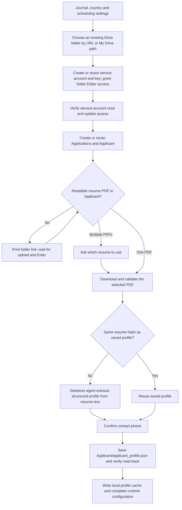

# Drive and applicant onboarding

Run `python3 -m services.onboarding` for a new installation, or
`python3 -m services.onboarding --applicant` for the Drive/applicant stages on an
existing installation. Install `requirements.txt`, gcloud and OpenSSL first.
Authenticate the agent provider before extraction (the default is local Codex).



The service account has folder Editor permission. Owner OAuth is used for
initial file/folder creation because service accounts cannot own new files in
personal My Drive. The service account reads the uploaded résumé, writes the
profile content and verifies it. Google login may open during setup; no tokens
or keys are requested in chat. See [Google's service-account storage rules](https://developers.google.com/workspace/drive/api/guides/about-shareddrives).

```text
Chosen Drive folder/
├── Applications/
├── Applicant/
│   ├── your-resume.pdf
│   └── applicant_profile.json
└── .ai-job-search-system/
    └── workloads-internal-state/
```

The upload gate checks Drive again after each Enter. Empty, corrupt, encrypted
or image-only PDFs cannot pass without readable text. Ctrl+C or EOF cancels;
no runtime configuration is created. Extraction errors and profile write or
read-back errors also prevent completion. Existing folders are reused; ambiguous
folder names must be resolved rather than silently choosing one.

The profile records a root-relative résumé path, Drive file ID and SHA-256.
Preparation retrieves that PDF through the Application Service and verifies its
hash. Replacing the file requires rerunning applicant onboarding. Existing
profiles in `.ai-job-search-system/` or at the root remain readable; profile writes
migrate the legacy file into Applicant while retaining its file ID.

`deployment/ctl.sh up` has a `prepare_applicant` stage immediately after
`provision_drive` and before deployment. Progress is recorded only when the
stage succeeds. The stage never substitutes a profile scaffold for extraction.
The provisioning container includes the PDF and phone parsing dependencies. Run
the local wizard first with your authenticated local agent; infrastructure setup
then reuses the extracted Drive profile for the same résumé. A container performing
fresh extraction needs its own configured agent provider/authentication.
