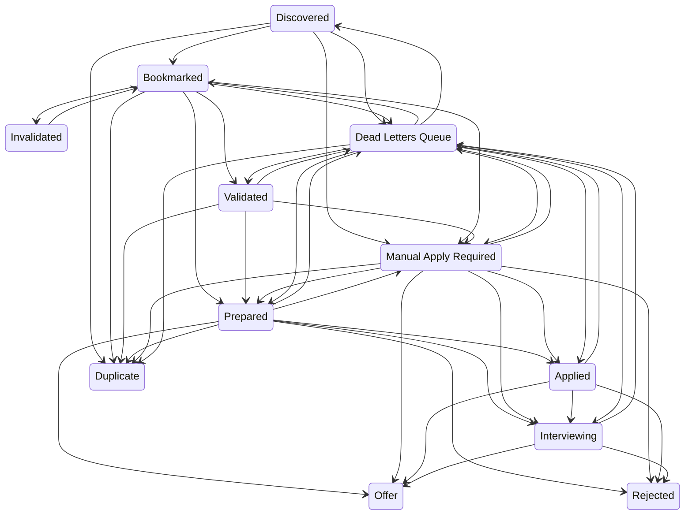
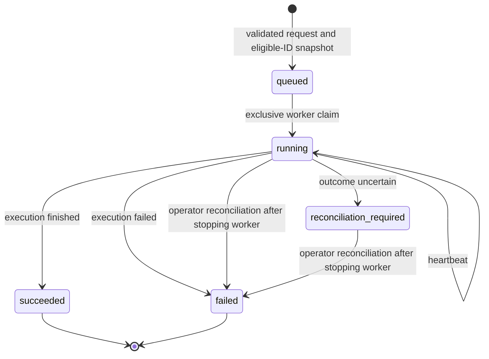
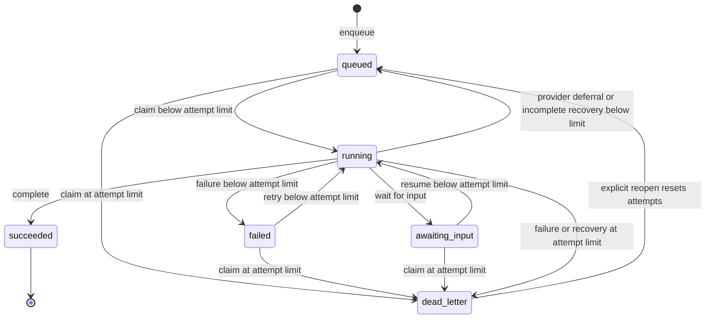
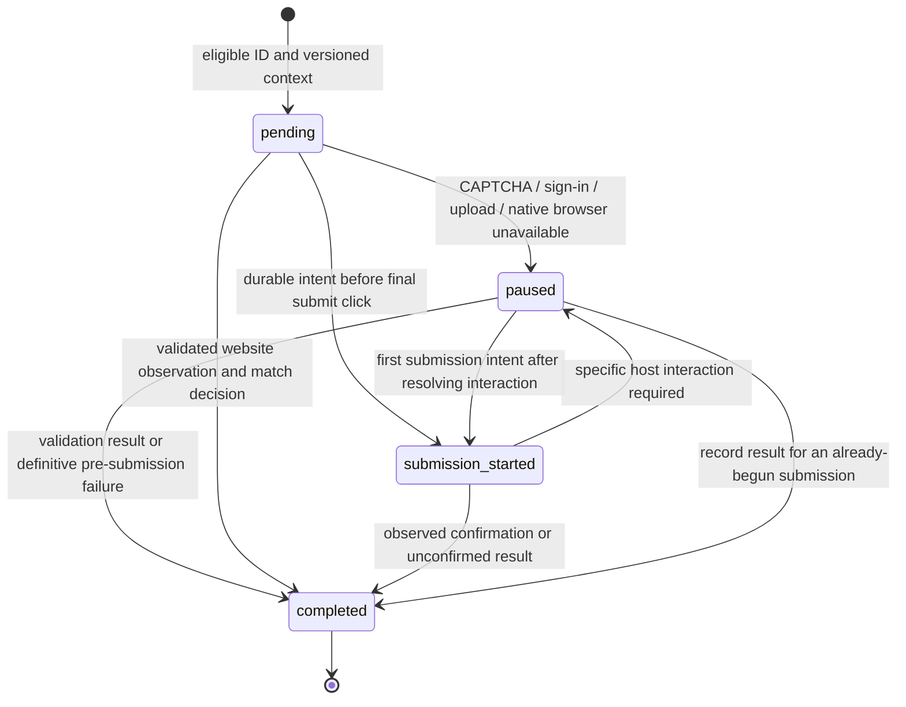

# State machines

## Application lifecycle

Source of truth: [`ALLOWED_TRANSITIONS`](../application_service/state_machine.py).
The chart includes every allowed change between distinct lifecycle states.
Labels describe API permissions; stage definitions and automation policy decide
which transition to request. All writes pass through the Application Service.

Same-state requests are safe no-ops in `validate_transition`, including terminal
states. Rejected, Offer and Duplicate have no outgoing lifecycle transitions.
Invalidated can return to Bookmarked. Dead Letters Queue is restored only by an
operator; permitted restoration targets appear above.

Prepared membership authorizes automatic submission. Failed auto-apply attempts
route to Manual Apply Required with an explanation; unconfirmed submissions must
be reconciled manually before retrying. System errors before submission route to
Dead Letters Queue. These policy rules narrow the API transition graph.

Journal completion/archive and duplicate removal are storage operations, not extra
lifecycle states. Completed application snapshots remain separate from active queues.

## Durable stage requests

Source: [`application_service/stage_tasks.py`](../application_service/stage_tasks.py).
These are execution requests from MCP/REST, not application statuses. A request
can select a named stage and snapshot its eligible application IDs. Existing
stage API names remain unchanged.

A running or reconciliation-required request blocks another claim. Claims are not
reissued on timeout. Finished requests cannot be retried or changed; repeating the
same status is idempotent. Reusing an admission key returns the original request;
changing its payload conflicts.

## Task execution registry (WorkloadRegistry)

Source: [`services/workload_registry.py`](../services/workload_registry.py).
Each workload registry record tracks a task for a named stage, distinct from a
whole execution request and from an application lifecycle state. A `WorkloadRegistry` entry has a `workload_id` and a `stage` identifying its
processing definition. The durable API command has a separate `stage_task_id`.

Provider deferral and waiting for input refund the current attempt. Recovery and
reopening are registry capabilities, not authorization to retry an uncertain
submission or consume the application Dead Letters Queue automatically. Application
policy and submission reconciliation checks still apply.

## Native ChatGPT task lifecycle

Source: [`chatgpt_tasks.py`](../application_service/chatgpt_tasks.py).
These are tasks within one admitted stage request, not application states.

A begin-command replay returns `may_submit: false`. A paused begun attempt cannot
start again. Uncertain persistence or changed execution contracts move the whole
run to `reconciliation_required`. The service does not automatically reclaim
these tasks or restart website actions on a timeout.
